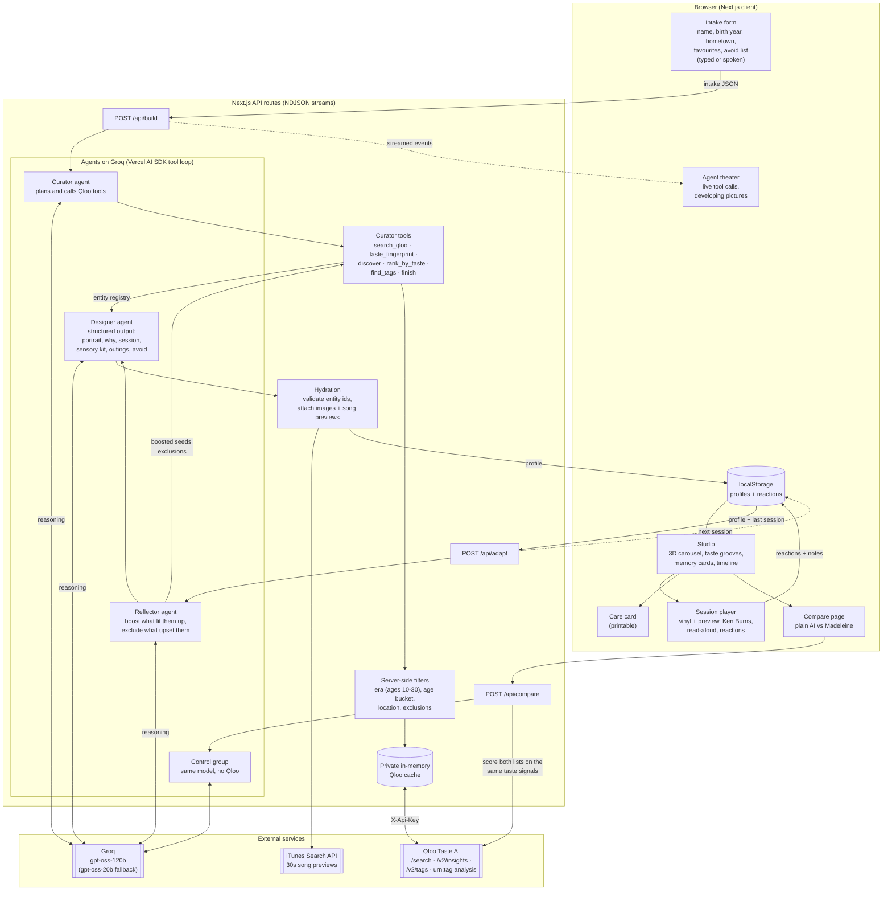
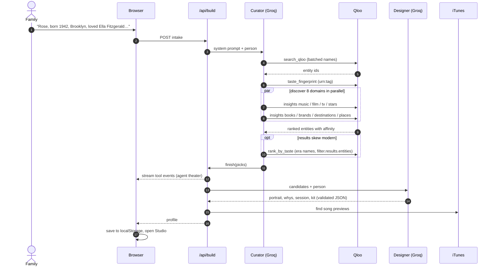

# Madeleine: the taste of memory


**An AI agent that rebuilds the cultural world of someone living with dementia** — the songs, films, faces, brands and places of their youth, matched to *their own* taste with Qloo's taste graph — and turns it into gentle reminiscence sessions that learn from every smile.

Built for the [Qloo Agentic Hackathon](https://qloo.devpost.com/).

> Named for Proust's madeleine: the taste of a little cake that brought his whole childhood rushing back.

## Why this needs Qloo

Musical and cultural memories are often among the last to fade in Alzheimer's disease, and we remember most vividly what happened between about ages 10 and 30 (the "reminiscence bump"). Reminiscence work is powerful — but only when it is *personal*.

Ask a plain language model about someone born in 1942 and every person gets the same list: Elvis, Casablanca, I Love Lucy. That is a decade, not a person. Qloo knows which records, films, faces and everyday things actually travel together in people's taste. Madeleine uses that to expand a handful of family-remembered favourites into a whole, era-correct, cross-domain world.

Every item Madeleine shows is a real Qloo entity. The LLM chooses and writes; it cannot invent an entity. Each profile has a live **"Compare with plain AI"** page that scores a no-Qloo list and Madeleine's list against the same taste signals.

## What it does

1. **Intake** — a family member types (or speaks) a name, birth year, hometown and a few favourites. Four one-click demo people (Brooklyn, Bombay, Liverpool, Mexico City).
2. **Curator agent** (Groq, tool-calling loop) works Qloo live, streamed to an "agent theater" UI:
   - `search_qloo` — resolve the family's names to entities
   - `taste_fingerprint` — Qloo taste analysis (`filter.type=urn:tag`)
   - `discover` — insights per domain: music, film, TV, stars, books, brands, destinations, nearby places; era (`release_year`, `publication_year`, `date_of_birth`), age (`signal.demographics.age`) and location filters applied server-side
   - `rank_by_taste` — LLM proposes era names it knows from history, Qloo ranks them by affinity (`filter.results.entities`)
   - `find_tags` — genre tags to steer discovery
3. **Designer agent** writes the portrait, a "why" for every item, a 20-minute session following reminiscence practice (invite, never quiz), a sensory kit, outings and an avoid list — as validated structured output. Songs are matched to real 30-second previews (iTunes Search API).
4. **Session player** — calm full-screen mode for the person: spinning vinyl with preview, Ken Burns stills, prompts read aloud (Web Speech), large reaction buttons, keyboard shortcuts.
5. **Reflector agent** — after a session, the moments that made them light up become new Qloo seed signals, upsetting ones are excluded (`filter.exclude.entities`), and the next session is planned with "what Madeleine learned".
6. **Studio** for families: 3D carousel, taste fingerprint (vinyl grooves), per-domain memory cards (vinyl sleeves, slide mounts, polaroids, CRTs, postcards, tickets), life timeline, sessions, comfort kit.
7. **Printable care card** for care-home staff, and a **Your people** dashboard.

Privacy: profiles live only in the browser's localStorage. No accounts, no server database. Qloo responses are cached privately in server memory only.

## Architecture



### Request lifecycle



## Stack

Next.js 16 (App Router) · TypeScript · Tailwind CSS v4 · Vercel AI SDK (`generateText` tool loop, structured output) · Groq (`openai/gpt-oss-120b`, fallback `openai/gpt-oss-20b`) · Qloo Insights API · React Three Fiber + drei · motion · Vercel.

## Run it locally

```bash
cp .env.example .env.local   # add QLOO_API_KEY and GROQ_API_KEY
npm install
npm run dev                  # http://localhost:3000
```

## Project map

```
src/lib/qloo.ts             Qloo client (search, insights, taste tags, tags) + private cache
src/lib/agent/tools.ts      Curator tools the model calls
src/lib/agent/pipeline.ts   Curator -> Designer -> hydration; Reflector (adapt)
src/lib/agent/generic.ts    The no-Qloo control group + same-scale taste check
src/app/api/*               NDJSON streaming routes: build, adapt, compare
src/components/*            Agent theater, memory cards, studio, session player, 3D hero
```

## Disclaimer

Madeleine supports carers; it is not a medical device and does not treat dementia.

## License

[MIT](./LICENSE)
